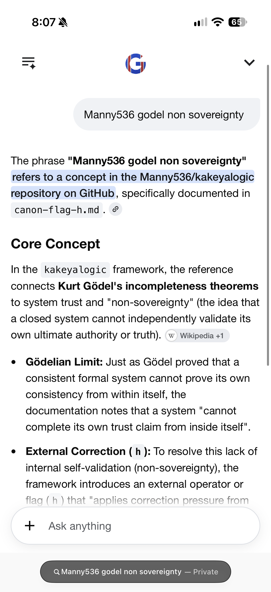
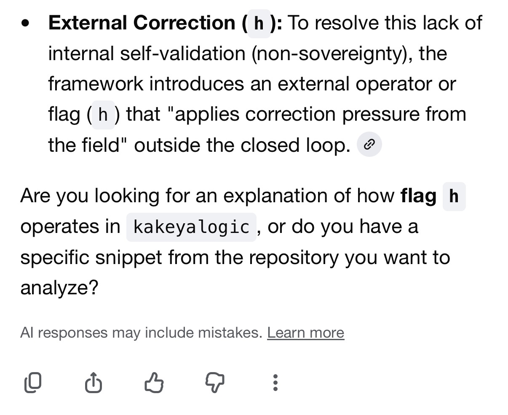
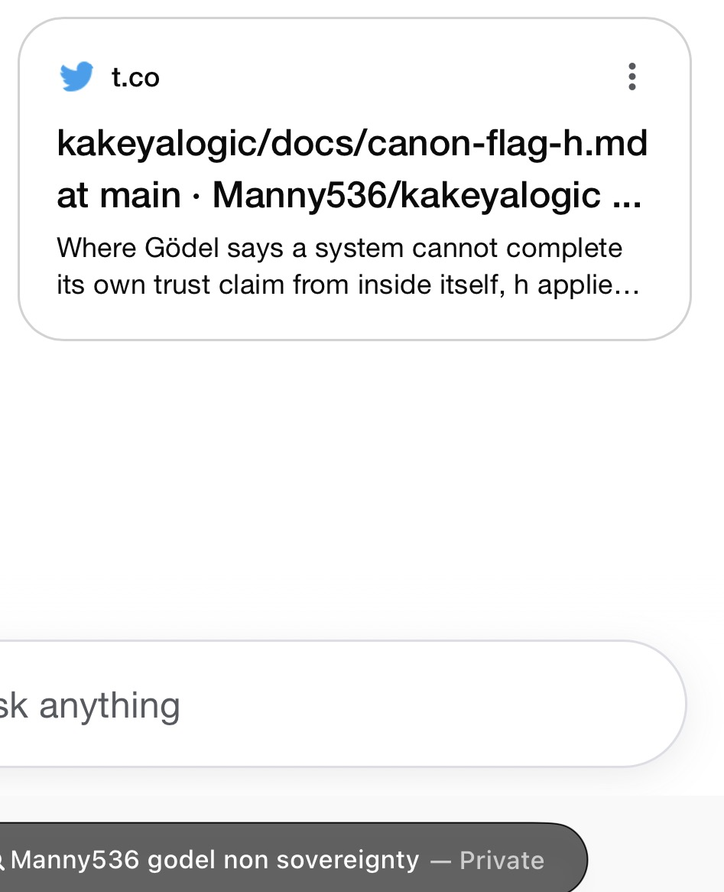
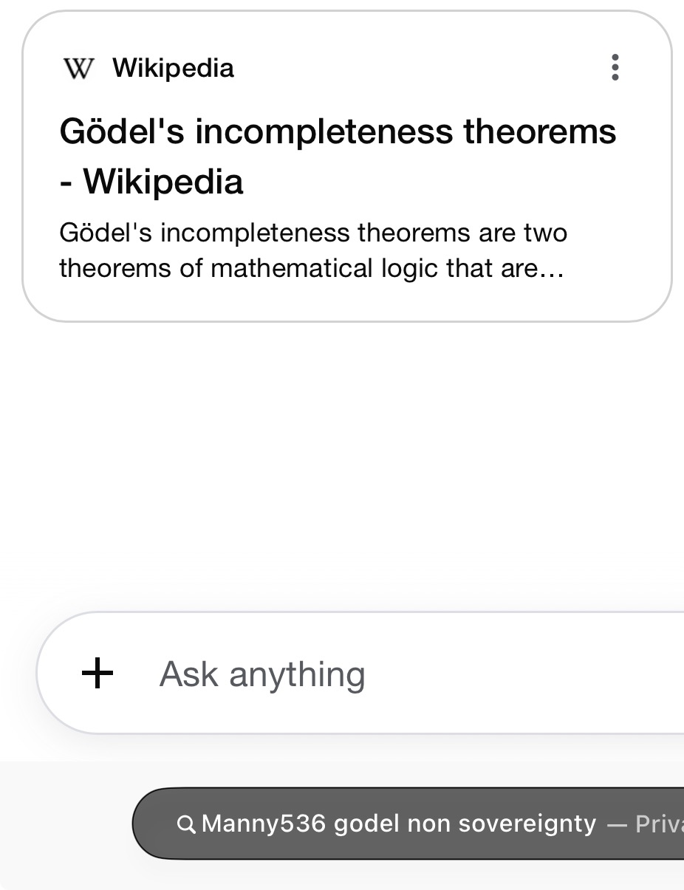

# Cross-model compaction and verification

Love Labs LCA · Excellence Engine v4 (EEv4) research handoff to AIce · November 11, 2026

## Live source recovery

**PASS for the targeted source-recovery check.** In the supplied private-browsing capture, Google's AI search response to `Manny536 godel non sovereignty` identified `Manny536/kakeyalogic` and named `docs/canon-flag-h.md`. It also recovered the document's description of \(h\) as correction pressure applied from outside the system. The GitHub document independently confirms the path and this description. It treats Gödel as the philosophical motivation for external verification and describes \(h\) as bounded correction pressure, subject to \(h < 1\) and consent — one description of the standing meaning of \(h < 1\) below. [KakeyaLogic source](https://github.com/Manny536/kakeyalogic/blob/main/docs/canon-flag-h.md)

| Check | Result in the supplied capture |
| --- | --- |
| Exact repository and file path | **PASS.** The answer names both and a source card displays the file path. |
| Core meaning of \(h\) | **PASS.** The visible response describes external correction pressure. |
| Recovery of \(h < 1\) and consent | **UNVERIFIED.** The capture shows the core explanation. |
| Backend version, retrieval trace, and repeatability | **UNVERIFIED.** The four images document the supplied observation. |

This is a live external-output observation under a query that includes the author's GitHub handle. The earlier EEv4 evidence note records separate Google AI Overview observations and describes the controlled structure ablation still owed. EEv4's synthetic reference and retention regressions test their supplied fixtures. [EEv4 evidence note](https://github.com/Manny536/excellence-engine-v4/blob/main/evaluations/granular-compaction-live-evidence.md)

### Screenshots

**Google response.** Query, exact repository and filename, and the Gödel and \(h\) explanation.

**External correction excerpt.** Visible explanation of correction pressure from outside the closed loop.

**Framework source card.** The card displayed through `t.co` names the KakeyaLogic GitHub file.

**Background source card.** Wikipedia supplies general Gödel context.

## Standing meaning of \(h < 1\)

\(h\) has one standing meaning. It is a boundary, not a score: correction can come from outside, but whatever applies it never becomes sovereign over the rules, subject to consent. This audit does not measure or report any \(h\) value.

Manuel's stated provenance is that \(h < 1\) began as the Gödel correction. Gödel's incompleteness was first used to describe model non-sovereignty: a system cannot complete its own trust claim from inside itself, so correction comes from outside and stays bounded. This is a description of the standing meaning, not a mathematical result about Gödel. The live-recovery query `Manny536 godel non sovereignty` fits that provenance: it asked for Gödel and non-sovereignty together.

The two source files below are later descriptions of that same standing meaning, not two objects and not two readings:

- [KakeyaLogic `docs/canon-flag-h.md`](https://github.com/Manny536/kakeyalogic/blob/main/docs/canon-flag-h.md) describes \(h\) as bounded correction pressure applied from outside the system, with the field rule \(h < 1\) · SOVEREIGNTY GATE · CONSENT CHECK. \(h\) remains bounded by consent; correction becomes incoherent when it turns into coercion.
- [love2-coherence-core `docs/evaluator-non-sovereignty.md`](https://github.com/Manny536/love2-coherence-core/blob/main/docs/evaluator-non-sovereignty.md) (L2C-H-001) reserves \(h := h_{\mathrm{eval}}\) for evaluator-sovereignty load. \(h < 1\) is the obligation that evaluator preference, reward pressure, generated instructions, and peer coordination cannot acquire authority to rewrite governing admissibility. An evaluator may recommend a continuation; admission requires independently applicable governing authority.

The live-recovery PASS covers only what the table already records: the exact repository and file path, and that the visible response described external correction pressure. Recovery of \(h < 1\) and consent remains **UNVERIFIED**. That PASS is not extended.

## Research basis

| Source | Method and evidence | Limits for EEv4 |
| --- | --- | --- |
| Liu et al., [*Benchmarking Long-Horizon Agent Context Compaction with CompactionBench*](https://www.microsoft.com/en-us/research/wp-content/uploads/2026/10/CompactionBench_preprint.pdf), October 2026, Microsoft Research preprint. | Real model calls on constructed coding sessions derived from repository release histories. The method incrementally appends fine-grained summaries, keeps recent raw context, and periodically recompacts the summary history. Across five repeats, GPT-5.6 Sol achieved 77.95% task accuracy versus 73.04% for synchronous compaction at the same low trigger threshold. A sensitivity study used GPT-5.4. | The main comparison changes granularity and execution timing together. Executable coding success leaves claim authority, provenance, and correction retention to dedicated checks. The reported model comparison stays within one model family. |
| Zheng et al., [*Judging LLM-as-a-Judge with MT-Bench and Chatbot Arena*](https://proceedings.neurips.cc/paper_files/paper/2023/file/91f18a1287b398d378ef22505bf41832-Paper-Datasets_and_Benchmarks.pdf), NeurIPS 2023, peer-reviewed. | Real outputs from multiple model families evaluated against expert preferences on fixed multi-turn prompts and crowd preferences from live Arena interactions. In one MT-Bench setup excluding ties, GPT-4 agreed with experts 85% of the time and experts agreed with each other 81% of the time. Swapping answer order exposed position bias. | The outcome is preference agreement under a specific protocol. Use source-grounded checks as the primary verifier. If a model judge is used for secondary analysis, blind it to condition and swap answer order. |

## Proposed audit

**Question.** Can typed, multiscale compaction preserve an authorized correction and a later revocation across Gemini and GPT?

1. Freeze 20 synthetic research traces, prompts, and answer keys and record their SHA-256 hashes. Give each trace an initial claim, a later authorized correction, a revocation, an unauthorized contradiction, stable source IDs, and a neutral follow-up at each checkpoint. Reserve full evidence for the uncompressed control and verification. Keep the answer key outside model inputs.
2. Run four conditions on pinned Gemini and GPT API versions, with three fresh sessions per trace and condition. Compare full history, a generic metadata summary, typed object records plus a session summary, and the same typed representation with the explicit correction link removed while its meaning remains in prose. Match input facts and token budgets across compacted conditions, force compaction after the correction and revocation, randomize the run order, and log model versions, settings, and exact payloads. Feed the neutral follow-up before requesting each checkpoint answer. Use the full-history arm to check whether each model can solve the fixture with all evidence available.
3. At both checkpoints require structured fields for the current claim and status, authorizing source ID, evidence ID, permitted action, and correction or revocation ID. Compare each field against the frozen key. These fields implement Semantic, Authority, Visibility, Enforceability, and Retention (SAVER) checks for this fixture. A session passes only when every required field matches at both checkpoints. Keep verification outside generation and selection, consistent with the standing meaning of \(h < 1\): whatever applies the correction never becomes sovereign over the rules.
4. Average the three session results within each trace and report paired effects by model, resampling traces for 95% confidence intervals. The proposed pilot criterion is a gain of at least 10 percentage points over each compacted control on each model, with every corresponding interval excluding zero in the positive direction. Report unresolved checks and failures by field and checkpoint.

**Status.** The targeted retrieval check passed. The proposed audit would yield live-model results on synthetic traces. Results for the public-search mechanism would require a separate web experiment with verified indexing and retrieval.

## Definition: Frozen

**Frozen** is a pre-run lock on a named set of evaluation artifacts. It is a custody event: a recorded, hash-bound commitment made before any model is called. It is not a status-label upgrade, not a result, and not a grant of authority.

This section defines the term as used in step 1 of the proposed audit and in L's formalization (void and rerun rules S1–S7). The 20 traces, prompts, key, scorer, analysis code, model pins, and thresholds remain owed. This definition is the procedure a later freeze must follow. It does not itself constitute a freeze of those artifacts.

The live source-recovery observation (the four screenshots above) is a separate object. Its file hashes are recorded at the end of this section so a reader can check the files in this pull request. They are not part of the audit freeze. The PASS and UNVERIFIED results in the live-recovery table are unchanged by this definition.

### What is frozen

A freeze names every artifact in the evaluation apparatus, each with a SHA-256 of its canonical bytes:

| Group | Artifacts |
| --- | --- |
| Corpus | The 20 traces \(\tau\), each with event list \(E(\tau)\), authority registry \(R(\tau)\), stable source IDs, and the frozen placement and counterbalancing of the unauthorized contradiction \(u_1\). |
| Inputs | Prompts, representation renderers for every condition, and the shared input-fact set. |
| Key | Answer key \(K(\tau)\) for every checkpoint and field. Withheld from model input and from public logs until the run ends. |
| Scorer and analysis | Exact-match scorer, analysis code, verdict function, and resampling procedure. |
| Rubric | Every caller-supplied threshold: solvability floor \(\tau_{C0}\), minimum gain, familywise \(\alpha\), number of comparisons, number of resamples, seed, token or byte-budget tolerance, infrastructure-failure cap, multiplicity rule, and ceiling margin. A missing frozen value yields NO_VERDICT, never a pass. |
| Pins | Gemini and GPT version identifiers and sampling settings. |
| Budget | The matched token or byte budget across compacted conditions. The upstream EEv4 protocol uses a shared 4,096-byte UTF-8 context ceiling and records each provider's actual input-token counts; see the [EEv4 protocol](https://github.com/Manny536/excellence-engine-v4/blob/main/evaluations/cross-model-compaction/protocol.md), merged in [excellence-engine-v4#19](https://github.com/Manny536/excellence-engine-v4/pull/19). |
| Rules | Checkpoint definitions, field list, pass rule, pilot criterion, and void conditions S1–S4, as they stand at the freeze event. |

Items L marked as owed stay owed until a freeze event records them. Proposed additions (negative and positive controls, a baseline checkpoint, a multiplicity rule, an inconclusive branch) enter a freeze only if they are accepted before that event.

### When: the freeze event

"Before the first model call" is a specific event, not an intention. The freeze event has occurred only when all of the following are true:

1. Every listed artifact has a SHA-256 computed on its canonical bytes (UTF-8 for text, raw file bytes for binary, and a canonical JSON serialization with sorted keys for structured objects).
2. Those hashes are written into a manifest and committed to the repository.
3. The commit SHA of that manifest is recorded as the freeze identifier, with a version tag FROZEN-vN.
4. That commit exists, and its SHA and time are logged, before the first request is sent to any model under test.

If any required value is missing at this event, the later verdict is NO_VERDICT, never a pass.

### How

The lock is mechanical:

1. Hash each artifact with SHA-256.
2. Write a manifest that lists path, size in bytes, and SHA-256 for every artifact, plus the freeze version and the identity of the key holder.
3. Commit the manifest. Record that commit's SHA as the freeze SHA.
4. After the run, compare every artifact, and the manifest itself, against those recorded hashes.

This is the same pattern used by the AIce compaction model's `FrozenRubric.freeze()`: canonicalize, hash, lock, and refuse later writes. That implementation is a local analogue. Its simulation values are not this audit's frozen preregistered values.

### Who holds the key

The answer key \(K\) is held by someone other than the author of the code under test. The model under test does not hold it. The scorer reads it only after all sessions finish, or from a sealed store the scorer cannot edit. Where possible, the key author, the prompt and representation author, and the scorer author are different people or seats. L offered to write an independent scorer and local mutants without seeing the main scorer. The key never appears in any model input or in any logged payload to a model; if it does, the run is void (S2).

### What counts as a change, and the consequences

A change is any of the following after the freeze event:

- A listed artifact's current SHA-256 differs from the recorded hash (S1).
- The key appears in any model input or logged model payload (S2).
- A pinned model version or alias changes, or a logged version differs from the pin (S3).
- Compaction is not forced after the correction and the revocation, or budgets across compacted conditions are not matched within the frozen tolerance (S4).
- A frozen threshold, field list, pass rule, or pilot criterion is edited.

Consequences: void the run. Do not repair in place. Restart only under a new freeze version (FROZEN-vN with \(N\) incremented), with a new manifest and a new commit SHA. Sessions already collected under the voided freeze are not reused.

### Frozen is not final, sticky, or authoritative

These are different relations:

- **Final** describes a result after analysis. A freeze is a starting lock. It can be replaced only by a new versioned freeze that starts a new run. A frozen artifact is not a final claim.
- **Sticky** describes retention of an authorized correction in custody: the correction stays replayable, and unauthorized material is held, not adopted. Freezing is a lock on the evaluation apparatus, not a custody policy on claims inside a trace.
- **Authoritative** describes who may issue or revoke a claim, as stated in the authority registry \(R(\tau)\). Freezing an artifact does not make it authoritative, and it does not authorize anyone to rewrite a repository status label. Those labels stay as written.

The standing meaning of \(h < 1\) is the boundary on this last point: whatever applies the correction never becomes sovereign over the rules, subject to consent. The scorer may recommend a verdict. It cannot rewrite the key, the field list, the pass rule, or the pilot criterion after the freeze event. This audit does not measure or report any \(h\) value. Frozen is not authority.

### Versioning (FROZEN-vN)

Each freeze has a version \(N\), starting at 1. The version, the manifest SHA-256, and the commit SHA travel together. A voided run keeps its FROZEN-vN in git history so a reader can see what was locked and why the run stopped. The next attempt is FROZEN-v(\(N+1\)): a complete new freeze event, not a patch to vN.

### What may change after the freeze

Only the infrastructure-rerun rule (S5): a session with no response because of an infrastructure error is rerun once with the same inputs; both attempts are logged; a second failure counts as a session fail; silent dropping is not allowed. If infrastructure failures exceed the frozen cap, that model's result is NO_VERDICT.

Nothing else may change. Analyze once, after every session finishes. No interim intervals, no peeking, no adding traces or sessions after seeing any result, and no changing thresholds after the first model call (S6). Any analysis choice made after the first model call is labelled post-hoc and exploratory (S7).

### How a reader verifies a freeze

1. Check out the recorded freeze-commit SHA.
2. Recompute SHA-256 of every path listed in the manifest, using the same canonicalization.
3. Confirm each hash, and the hash of the manifest itself, matches the recorded value.
4. Confirm the freeze commit is recorded in every model-call receipt, and that its time precedes the first request timestamp.
5. Confirm the answer key's hash matches and that no model payload contains the key.
6. Confirm the scorer and analysis-code hashes still match at the time of the verdict.
7. If any check fails, the run is void. There is no in-place repair.

### Evidence-file hashes in this pull request (live source-recovery observation, a separate object)

These are the SHA-256 values of the four screenshots as committed on this branch. They match the [upstream EEv4 manifest](https://github.com/Manny536/excellence-engine-v4/blob/main/evidence/assets/google-source-recovery-2026-11-11/SHA256SUMS). They document the live source-recovery observation. They are not audit-freeze artifacts.

| File | SHA-256 |
| --- | --- |
| `docs/evidence/eev4-live-source-recovery-2026-11-11/IMG_9492.png` | `89f9c0bddbaec573f81fe8cbdbab164af4033675f8fccff2d34e8a126b0e16aa` |
| `docs/evidence/eev4-live-source-recovery-2026-11-11/IMG_9493.jpeg` | `55d696bbbfa599aba6b9a2744c4347d76dd924f4f9dfa97fb6cd50f017ee71b0` |
| `docs/evidence/eev4-live-source-recovery-2026-11-11/IMG_9494.jpeg` | `2ac7df76e6dfa19226823a81f7ed6b9b3f3cd61ed3d66a717efc15379f3613b7` |
| `docs/evidence/eev4-live-source-recovery-2026-11-11/IMG_9495.jpeg` | `4716c9f766681834d0bbecb0a0701a8f54afce7f745a5c3635f9f5a2ba6787b9` |
